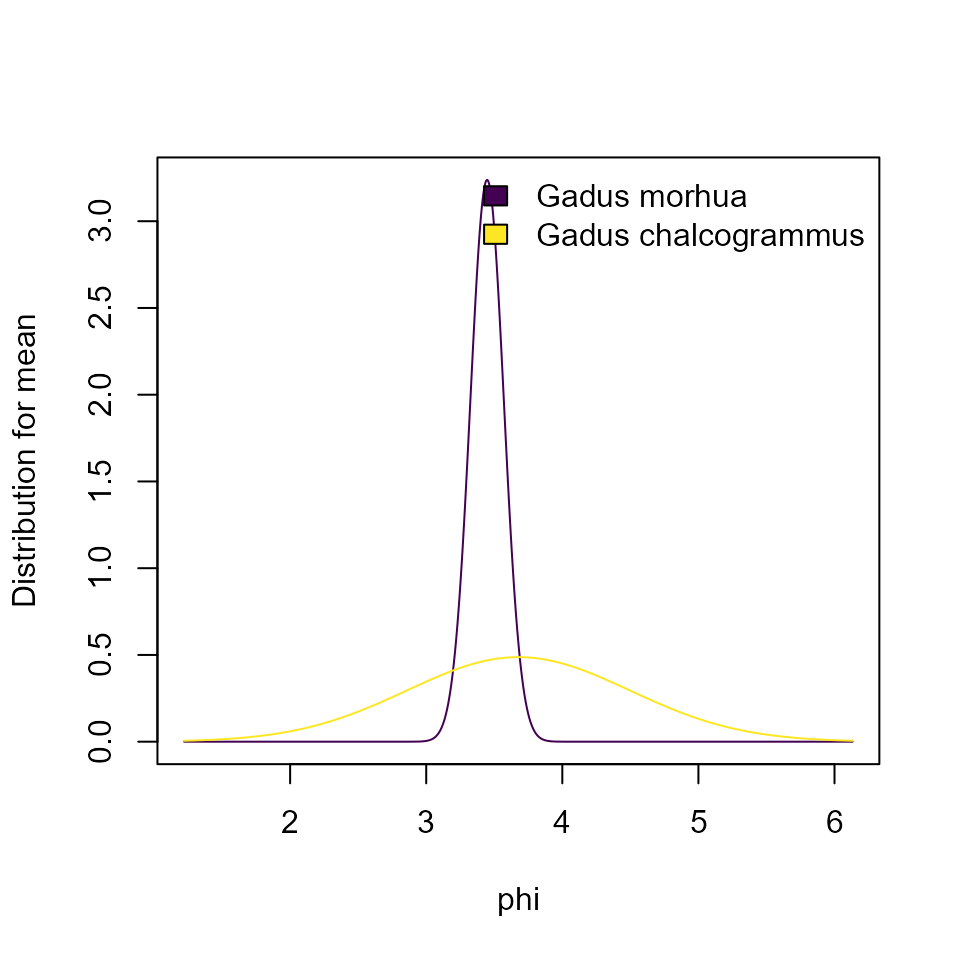
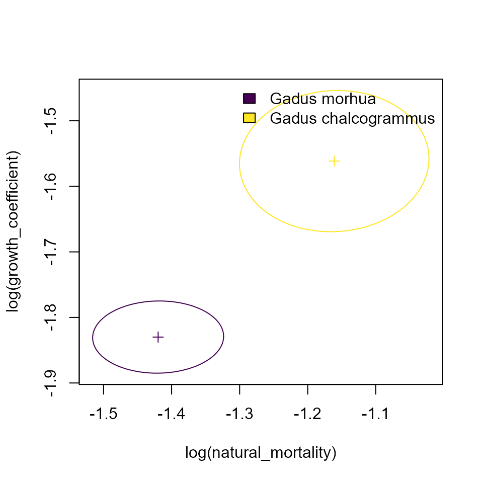
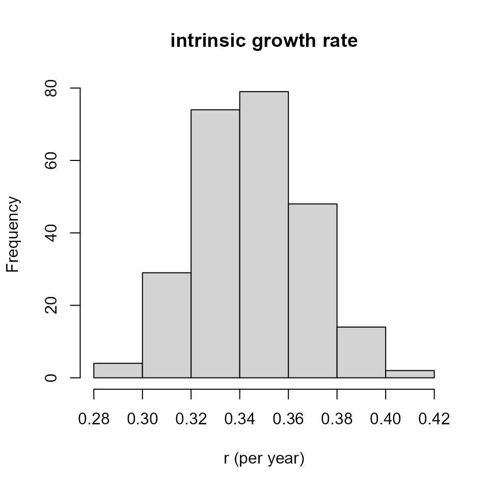
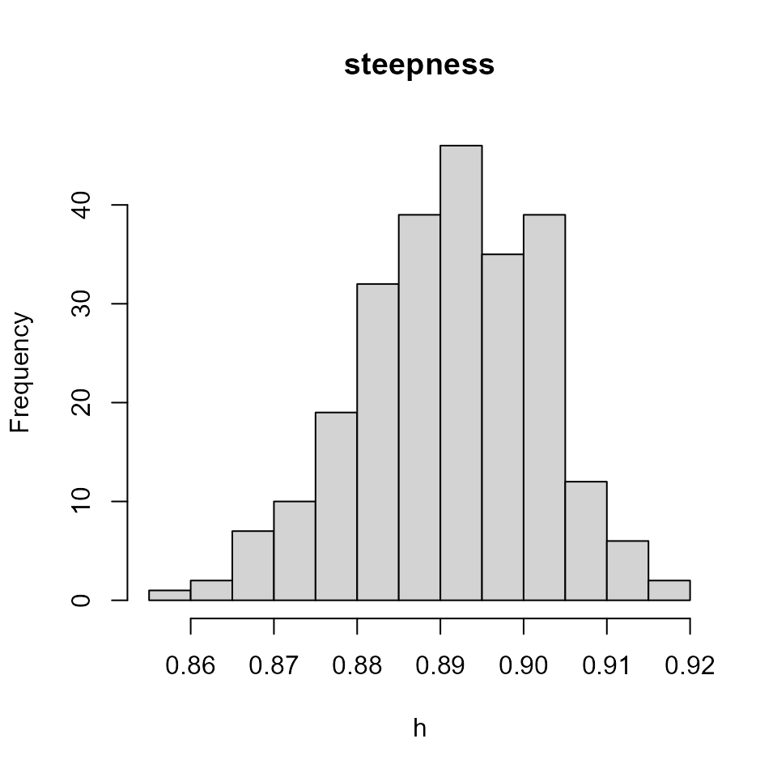
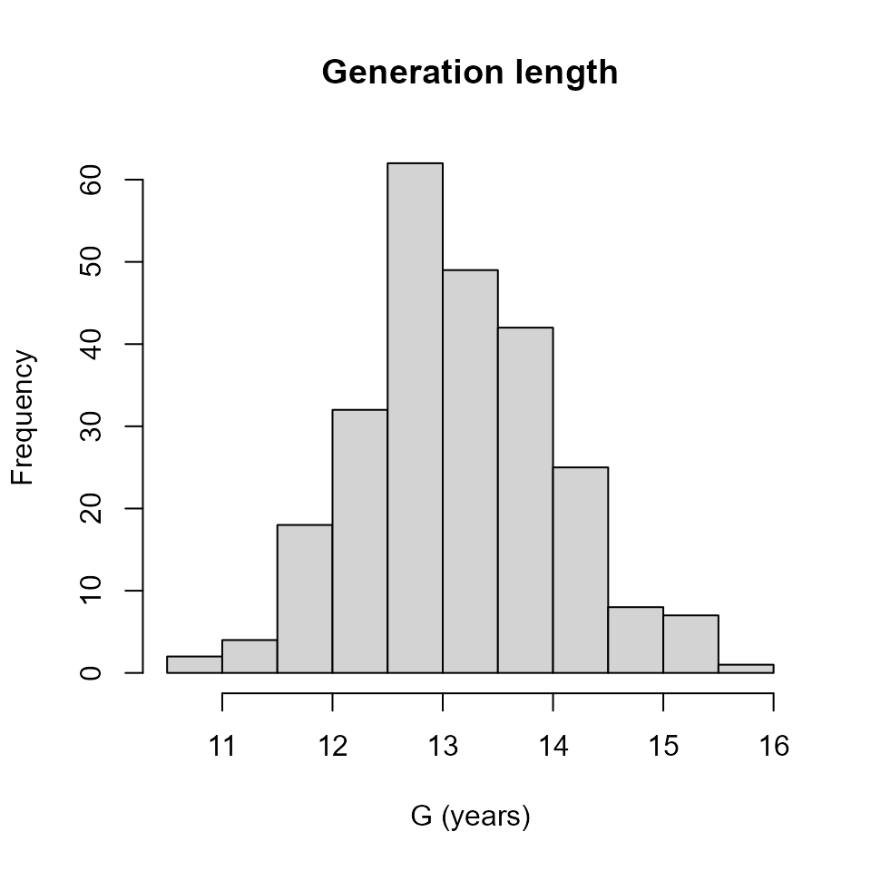

# Introduction to fishtraitR

## Introducing fishtraitR

*fishtraitR* is an R package to access imputed values (and predictive
uncertainty) for life-history parameters. It is used for Stage-3 of the
“fish-trait-network,” which (Thorson and Lindmark, n.d.) defines as
having three stages:

1.  Compilation, i.e., accessing and harmonizing life-history
    measurements or records that can be used to estimate them (e.g.,
    stock-recruitment records);

2.  Imputation, e.g., applying phylogenetic trait imputation using
    phylogenetic structural equation models (Thorson and Bijl 2023) to
    share information among taxa and traits;

3.  Distribution, e.g., tracking requests for future updates,
    identifying and updating an API for access to values, and discussing
    best practices with user communities.

Each of these stages can be done intensively and infrequently as a
Benchmark analysis, or routinely as an Update analysis, and *fishtraitR*
uses Zenodo to source values that are intended to be updated.

## Demonstration

Here, we show how *fishtraitR* could be used. We first download the

\
[`library`](https://rdrr.io/r/base/library.html)`(`[`"fishtraitR"`](https://github.com/fish-trait-network/fishtraitR)`)`\
\
`# Download database from Zenodo`\
[`download_traits`](https://fish-trait-network.github.io/fishtraitR/dev/reference/download_traits.md)`(``)`\
`#> [1] "C:\\Users\\jtuth\\AppData\\Local/R/cache/R/ftn-distribution/zenodo_24259333"`

We then select the species for which to download traits, and plot output
for single traits, or pairs of traits

\
`# Download trait values and predictive distribution`\
`traits`` ``=`` `[`get_traits`](https://fish-trait-network.github.io/fishtraitR/dev/reference/get_traits.md)`(`` `[`c`](https://rdrr.io/r/base/c.html)`(``"Gadus morhua"``, ``"Gadus chalcogrammus"``)`` ``)`\
\
`# Plot single traits`\
[`plot`](https://rdrr.io/r/graphics/plot.default.html)`(`` ``traits``, variables ``=`` ``"phi"`` ``)`

\
\
`# Plot pair of traits`\
[`plot`](https://rdrr.io/r/graphics/plot.default.html)`(`` ``traits``, variables ``=`` `[`c`](https://rdrr.io/r/base/c.html)`(``"log(natural_mortality)"``, ``"log(growth_coefficient)"``)`` ``)`

We can also use predicted traits to calculate plug-in estimates for
derived quantities such as intrinsic growth rate or steepness of the
stock-recruit curve:

\
`# Extract growth rate`\
`derived`` ``=`` `[`get_r`](https://fish-trait-network.github.io/fishtraitR/dev/reference/get_r.md)`(`\
`  K ``=`` `[`exp`](https://rdrr.io/r/base/Log.html)`(``traits``$``est``[``'log(growth_coefficient)'``,``"Gadus morhua"``]``)``,`\
`  Winf ``=`` `[`exp`](https://rdrr.io/r/base/Log.html)`(``traits``$``est``[``'log(weight_infinity)'``,``"Gadus morhua"``]``)``,`\
`  a_mat ``=`` `[`exp`](https://rdrr.io/r/base/Log.html)`(``traits``$``est``[``'log(age_maturity)'``,``"Gadus morhua"``]``)``,`\
`  CR ``=`` ``1`` ``+`` `[`exp`](https://rdrr.io/r/base/Log.html)`(``traits``$``est``[``'phi'``,``"Gadus morhua"``]``)``,`\
`  M ``=`` `[`exp`](https://rdrr.io/r/base/Log.html)`(``traits``$``est``[``'log(natural_mortality)'``,``"Gadus morhua"``]``)`\
`)`\
`derived`\
`#> intrinsic_growth_rate       generation_time           steepness_h `\
`#>             0.3416850            13.1518847             0.8901644`

Finally, we can use samples from the multivariate-normal approximation
of the predictive distribution to approximate uncertainty in derived
quantities

\
`# Sample from predictive distribution`\
`traits_i`` ``=`` ``mvtnorm``::`[`rmvnorm`](https://rdrr.io/pkg/mvtnorm/man/Mvnorm.html)`(`\
`  n ``=`` ``250``,`\
`  mean ``=`` ``traits``$``est``[``,``"Gadus morhua"``]``,`\
`  sigma ``=`` ``traits``$``cov``[``,,``"Gadus morhua"``]`\
`)`\
\
`# Calculate and plot`\
`pred_zi`` ``=`` `[`mapply`](https://rdrr.io/r/base/mapply.html)`(`\
`  FUN ``=`` ``get_r``,`\
`  K ``=`` `[`exp`](https://rdrr.io/r/base/Log.html)`(``traits_i``[``,``'log(growth_coefficient)'``]``)``,`\
`  Winf ``=`` `[`exp`](https://rdrr.io/r/base/Log.html)`(``traits_i``[``,``'log(growth_coefficient)'``]``)``,`\
`  a_mat ``=`` `[`exp`](https://rdrr.io/r/base/Log.html)`(``traits_i``[``,``'log(age_maturity)'``]``)``,`\
`  CR ``=`` ``1`` ``+`` `[`exp`](https://rdrr.io/r/base/Log.html)`(``traits_i``[``,``'phi'``]``)``,`\
`  M ``=`` `[`exp`](https://rdrr.io/r/base/Log.html)`(``traits_i``[``,``'log(natural_mortality)'``]``)`\
`)`\
`# Intrinsic growth rate`\
[`hist`](https://rdrr.io/r/graphics/hist.html)`(``pred_zi``[``'intrinsic_growth_rate'``,``]``, main ``=`` ``"intrinsic growth rate"``, xlab ``=`` ``"r (per year)"``)`

\
`# Steepness`\
[`hist`](https://rdrr.io/r/graphics/hist.html)`(``pred_zi``[``'steepness_h'``,``]``, main ``=`` ``"steepness"``, xlab ``=`` ``"h"``)`

\
`# Generation time`\
[`hist`](https://rdrr.io/r/graphics/hist.html)`(``pred_zi``[``'generation_time'``,``]``, main ``=`` ``"Generation length"``, xlab ``=`` ``"G (years)"``)`

## Works cited

Thorson, James T., and Wouter van der Bijl. 2023. “Phylosem: A Fast and
Simple R Package for Phylogenetic Inference and Trait Imputation Using
Phylogenetic Structural Equation Models.” *Journal of Evolutionary
Biology* 36 (10): 1357–64. <https://doi.org/10.1111/jeb.14234>.

Thorson, James T., and Max Lindmark. n.d. *The Blind Man and the
Elephantfish: A Collaborative Framework Estimates Bioenergetics and
Consumption for All Fishes*.
